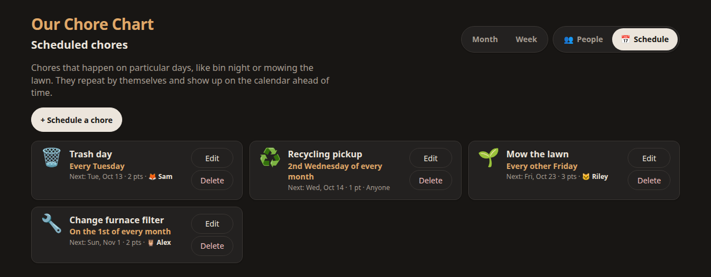

# Chore Chart

A shared chore calendar for a household. Put it on a kitchen tablet, open it on everyone's
phones, and tap your face when you've done a chore. Points add up per day, week and month;
everyone gets their own daily goal; bin night and lawn-mowing show up on the calendar by
themselves.

One small container, no accounts, no cloud, no database to run. Your data stays in two JSON
files on your own machine.


## Features

- **Month and week calendars** with a scoreboard for the period on screen: points, days at
  goal, and who's on top.
- **Log from any device.** Everyone sees the same chart; a chore logged on a phone appears on
  the tablet within seconds. Two people can't claim the same chore.
- **Per-person daily goals.** A six-year-old can aim for 2 points while a teenager aims for 6;
  "goal met" is judged against each person's own number.
- **Scheduled chores that repeat**: every Tuesday, every other Friday, the 2nd Wednesday of
  the month, the 1st of every 3 months. They appear on the calendar ahead of time, marked done
  or missed afterwards, with an optional "whose turn".
- **Pick a critter.** Each person chooses a colour and an icon (🦉 🦊 🐱 🦄 🐙 🦖 and ~100 more).
- **Forgot yesterday?** Fill in any past day. Undo and reset per day.
- **Phone-first, works everywhere**: light and dark mode, big touch targets, screen-reader
  labels, reduced-motion support.
- **Backups** as a single JSON download, restorable with one request.

| Week | A day on a phone | Scheduled chores |
| --- | --- | --- |
|  |  |  |

## Quick start (Docker)

```bash
docker run -d --name chore-chart --restart unless-stopped \
  -p 8420:8420 \
  -e TZ=America/New_York \
  -e CHORE_TITLE="Our Chore Chart" \
  -v chore-data:/data \
  ghcr.io/morningstarowl/chore-chart:latest
```

Then open `http://<that-machine's-IP>:8420/` on any phone, tablet or computer on your network.
Images are published for `amd64` and `arm64`, so a Raspberry Pi works.

Or with Docker Compose, using [`compose.yaml`](compose.yaml) from this repo:

```bash
docker compose up -d
```

To build the image yourself instead: `docker build -t chore-chart .`

### First steps

1. Open **People**. Four sample people (Alex, Sam, Riley, Jordan) are there to start with:
   rename them, pick colours and critters, set each person's daily goal, add or remove people.
2. Open **Schedule** and add the chores that happen on particular days (bins, lawn, filters).
3. Bookmark the page (or "Add to Home Screen") on every device.

## Settings

All optional, as environment variables:

| Variable | Default | What it does |
| --- | --- | --- |
| `TZ` | `UTC` | Your time zone (e.g. `Europe/London`). Days roll over at your midnight. |
| `CHORE_TITLE` | `Chore Chart` | Title at the top of the page. |
| `CHORE_PORT` | `8420` | Port inside the container. |
| `CHORE_DATA_DIR` | `/data` | Where `days.json` and `household.json` are kept. |
| `CHORE_CONFIG_DIR` | *(unset)* | A folder with your own `chores.json` (and optionally `participants.json` / `icons.json`). Files you leave out fall back to the built-in ones. |
| `CHORE_TRUSTED_ORIGINS` | *(unset)* | Extra origins allowed to save changes, comma-separated. Only needed behind a reverse proxy that rewrites the `Host` header. |

### Your own everyday chores

The everyday chore list comes from [`config/chores.json`](config/chores.json). To use your
own, copy it into a folder, edit it, and mount it:

```yaml
    environment:
      CHORE_CONFIG_DIR: /config
    volumes:
      - chore-data:/data
      - ./my-config:/config:ro
```

```json
{ "chores": [
  { "id": "dishes",    "name": "Wash dishes", "points": 1, "slotsPerDay": 1 },
  { "id": "feed-pets", "name": "Feed pets",   "points": 1, "slotsPerDay": 2 }
] }
```

`id` must be unique and should never change once used (logged chores point at it). `points`
and `slotsPerDay` are whole numbers ≥ 1; `slotsPerDay: 2` lets two people each do it once a
day. Changes apply the next time the page loads, with no restart. If the list is too short for everyone's goals, a
yellow banner says so.

`participants.json` only seeds the household the very first time the server starts; after
that, people are managed on the People page.

## Backups

- **Download:** the *Download a backup* link at the bottom of every page, or
  `curl -o backup.json http://<host>:8420/api/export`.
- **Restore** (replaces everything on the server):
  `curl -X POST -H "Content-Type: application/json" --data-binary @backup.json http://<host>:8420/api/import`
- The data lives in the `/data` volume: `days.json` (what was done when) and `household.json`
  (people and schedules). Writes are atomic; if a file is ever damaged the server sets it
  aside and starts fresh rather than going down.

## Security

There are **no logins**: anyone who can reach the page can log chores and edit people and
schedules. That is deliberate for a home network. **Do not expose it to the internet** unless
you put it behind something that adds authentication (a reverse proxy with basic auth,
Tailscale, Cloudflare Access, etc.).

Built-in protections: names are always rendered as text (never HTML), a strict
Content-Security-Policy, writes must be JSON from the page's own origin (other websites
can't post to it), and the container runs as a non-root user.

## Running without Docker

Python 3.10+ and nothing else:

```bash
python3 server.py --port 8420 --data ./data
```

## Development

```bash
npm test     # 70 JavaScript tests (node --test) + 25 Python server tests; no dependencies to install
npm start    # http://127.0.0.1:8420/ with data in ./data
```

The front end is plain HTML, CSS and ES modules with no build step:

| File | |
| --- | --- |
| `server.py` | HTTP server, JSON API, storage, validation |
| `js/main.js` | Routing, data loading, polling |
| `js/views.js` | Month, week, day views and scoreboard |
| `js/settings.js` | People and Schedule pages |
| `js/schedule.js` | Repeat rules (`occursOn`, `describeRule`, `nextOccurrence`) |
| `js/calendar.js` | Date maths and period totals |
| `js/scoring.js` | Points per person |

The API is documented at the top of [`server.py`](server.py).

## License

[MIT](LICENSE)
