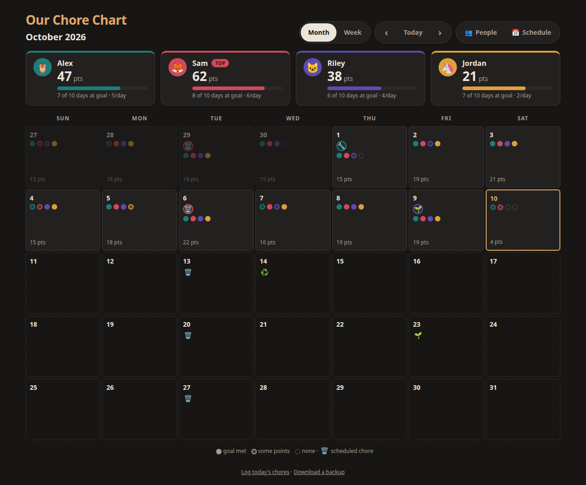
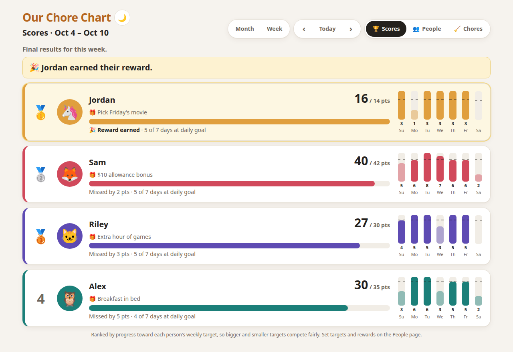
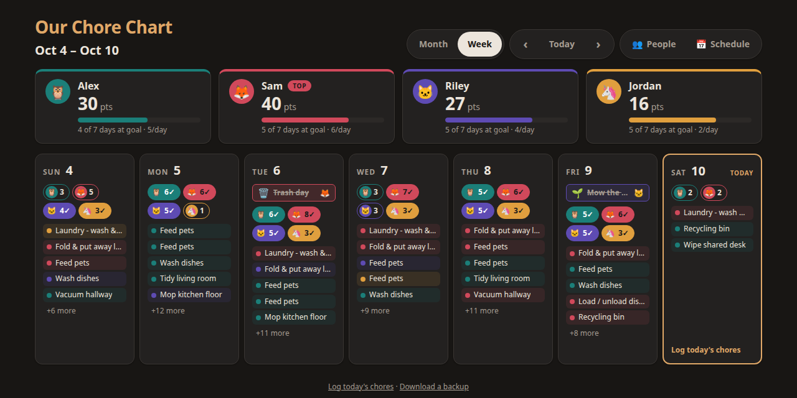
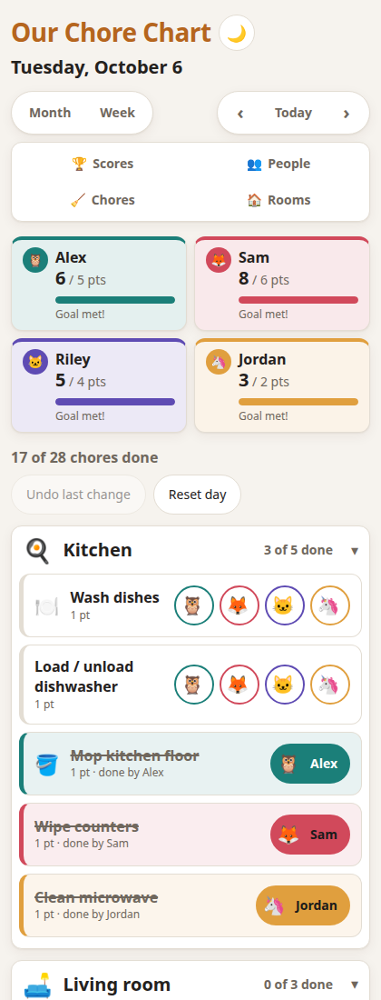
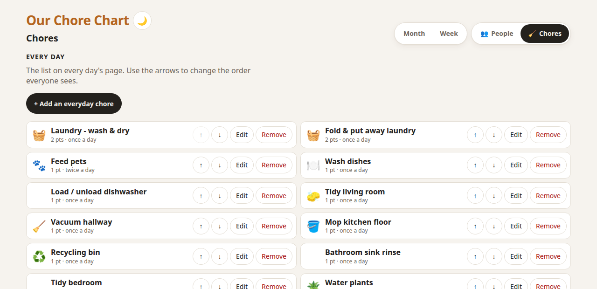

# Chore Chart

A shared chore calendar for a household. Put it on a kitchen tablet, open it on everyone's
phones, and tap your face when you've done a chore. Points add up per day, week and month;
everyone gets their own daily goal; bin night and lawn-mowing show up on the calendar by
themselves.

One small container (or a Home Assistant add-on), no accounts, no cloud, no database to run. Your data stays in two JSON
files on your own machine.





## Features

- **Month and week calendars** with a scoreboard for the period on screen: points, days at
  goal, and who's on top.
- **Log from any device.** Everyone sees the same chart; a chore logged on a phone appears on
  the tablet within seconds. Two people can't claim the same chore.
- **Weekly scores and rewards.** A Scores page that resets every Sunday: each person's points
  toward their own weekly target and the reward they're working for ("Pick Friday's movie"),
  day-by-day bars, a fair ranking by progress, and the last 8 weeks at a glance.
- **Per-person daily goals.** A six-year-old can aim for 2 points while a teenager aims for 6;
  "goal met" is judged against each person's own number.
- **Scheduled chores that repeat**: every Tuesday, every other Friday, the 2nd Wednesday of
  the month, quarterly, once a year on March 15, or every 90 days counted from the last time
  it was done (furnace filters). They appear on the calendar ahead of time, with an optional
  "whose turn", and rare ones can stay on the list, marked overdue, until someone does them.
- **Organised by room.** Each day's chores are grouped into collapsible rooms (Kitchen,
  Bathroom, Outdoors...) with their own "3 of 5 done" count; finished rooms fold away. Add,
  rename, reorder and remove rooms in the app, and pick each chore's room from a dropdown.
- **Edit the chore list in the app**: add, rename, re-icon, change points or "twice a day",
  reorder and remove everyday chores. Removing or changing a chore never erases points
  people already earned with it.
- **Pick a critter.** Each person chooses a colour and an icon (🦉 🦊 🐱 🦄 🐙 🦖 and ~100 more).
- **Forgot yesterday?** Fill in any past day. Undo and reset per day.
- **Phone-first, works everywhere**: light and dark mode (follows the device, or tap 🌙/☀️
  next to the title), big touch targets, screen-reader labels, reduced-motion support.
- **Backups** as a single JSON download, restorable with one request.

| Week | A day on a phone | Editing chores |
| --- | --- | --- |
|  |  |  |

## Home Assistant add-on

[](https://my.home-assistant.io/redirect/supervisor_add_addon_repository/?repository_url=https%3A%2F%2Fgithub.com%2FMorningstarOwl%2Fchore-chart)

Run it inside Home Assistant OS or Supervised: **Settings → Add-ons → Add-on Store → ⋮ →
Repositories**, add `https://github.com/MorningstarOwl/chore-chart`, then install **Chore
Chart**. It appears as **Chores** in the sidebar, is included in Home Assistant backups, and
uses Home Assistant's time zone. Port 8420 stays open on your network for phones and tablets
without a Home Assistant login (clear it in the add-on's Network settings to make the sidebar
the only way in). Moving from the Docker version: download a backup from it, then post it to
the add-on's `/api/import` (see the add-on's Documentation tab).

## Quick start (Docker)

```bash
docker run -d --name chore-chart --restart unless-stopped \
  -p 8420:8420 \
  -e TZ=America/New_York \
  -e CHORE_TITLE="Our Chore Chart" \
  -v chore-data:/data \
  ghcr.io/morningstarowl/chore-chart:latest
```

Then open `http://<that-machine's-IP>:8420/` on any phone, tablet or computer on your network.
Images are published for `amd64` and `arm64`, so a Raspberry Pi works.

Or with Docker Compose, using [`compose.yaml`](compose.yaml) from this repo:

```bash
docker compose up -d
```

To build the image yourself instead: `docker build -t chore-chart .`

### First steps

1. Open **People**. Four sample people (Alex, Sam, Riley, Jordan) are there to start with:
   rename them, pick colours and critters, set each person's daily goal and weekly reward,
   add or remove people.
2. Open **Chores**: trim the starter list of everyday chores to fit your home, and add the
   ones that happen on particular days (bins, lawn, filters).
3. Bookmark the page (or "Add to Home Screen") on every device.

## Settings

All optional, as environment variables:

| Variable | Default | What it does |
| --- | --- | --- |
| `TZ` | `UTC` | Your time zone (e.g. `Europe/London`). Days roll over at your midnight. |
| `CHORE_TITLE` | `Chore Chart` | Title at the top of the page. |
| `CHORE_PORT` | `8420` | Port inside the container. |
| `CHORE_DATA_DIR` | `/data` | Where `days.json` and `household.json` are kept. |
| `CHORE_CONFIG_DIR` | *(unset)* | A folder with your own `icons.json`, or a `chores.json` / `participants.json` to start a **new** household with. Files you leave out fall back to the built-in ones. |
| `CHORE_TRUSTED_ORIGINS` | *(unset)* | Extra origins allowed to save changes, comma-separated. Only needed behind a reverse proxy that rewrites the `Host` header. |
| `CHORE_TRUSTED_PROXY` | *(unset)* | IP of a proxy (e.g. Home Assistant ingress) whose same-site saves are accepted whatever their origin. |
| `CHORE_FRAME_ANCESTORS` | `'none'` | CSP `frame-ancestors`; the add-on uses `'self'` so it can appear in Home Assistant's sidebar. |

### Chores and people

Everything is edited in the app: **People** for who's in the house and their goals, **Chores**
for the everyday list and the scheduled ones, **Rooms** for how each day's list is grouped. A
new household starts with four sample people, seven rooms and the 24 everyday chores in
[`config/chores.json`](config/chores.json).

To start a new household from your own list instead, put a `chores.json` in a folder, mount it,
and point `CHORE_CONFIG_DIR` at it before the first start (it is not read again after that):

```json
{
  "rooms": [ { "id": "kitchen", "name": "Kitchen", "icon": "🍳" } ],
  "chores": [
    { "id": "dishes",    "name": "Wash dishes", "points": 1, "slotsPerDay": 1, "icon": "🍽️", "room": "kitchen" },
    { "id": "feed-pets", "name": "Feed pets",   "points": 1, "slotsPerDay": 2 }
  ]
}
```

`slotsPerDay: 2` means two people can each do it once a day (or one person twice).

## Backups

- **Download:** the *Download a backup* link at the bottom of every page, or
  `curl -o backup.json http://<host>:8420/api/export`.
- **Restore** (replaces everything on the server):
  `curl -X POST -H "Content-Type: application/json" --data-binary @backup.json http://<host>:8420/api/import`
- The data lives in the `/data` volume: `days.json` (what was done when) and `household.json`
  (people and schedules). Writes are atomic; if a file is ever damaged the server sets it
  aside and starts fresh rather than going down.

## Security

There are **no logins**: anyone who can reach the page can log chores and edit people and
schedules. That is deliberate for a home network. **Do not expose it to the internet** unless
you put it behind something that adds authentication (a reverse proxy with basic auth,
Tailscale, Cloudflare Access, etc.).

Built-in protections: names are always rendered as text (never HTML), a strict
Content-Security-Policy, writes must be JSON from the page's own origin (other websites
can't post to it), and the container runs as a non-root user.

## Running without Docker

Python 3.10+ and nothing else:

```bash
python3 server.py --port 8420 --data ./data
```

## Development

```bash
npm test     # 96 JavaScript tests (node --test) + 37 Python server tests; no dependencies to install
npm start    # http://127.0.0.1:8420/ with data in ./data
```

The front end is plain HTML, CSS and ES modules with no build step:

| File | |
| --- | --- |
| `server.py` | HTTP server, JSON API, storage, validation |
| `js/main.js` | Routing, data loading, polling |
| `js/views.js` | Month, week, day views and scoreboard |
| `js/settings.js` | People, Chores and Rooms pages |
| `js/stats.js` | Scores page: weekly standings, rewards, earlier weeks |
| `js/theme.js` | Light/dark switch (loaded before first paint) |
| `js/schedule.js` | Repeat rules (`occursOn`, `describeRule`, `nextOccurrence`) |
| `js/calendar.js` | Date maths and period totals |
| `js/scoring.js` | Points per person |

The API is documented at the top of [`server.py`](server.py).

## License

[MIT](LICENSE)
